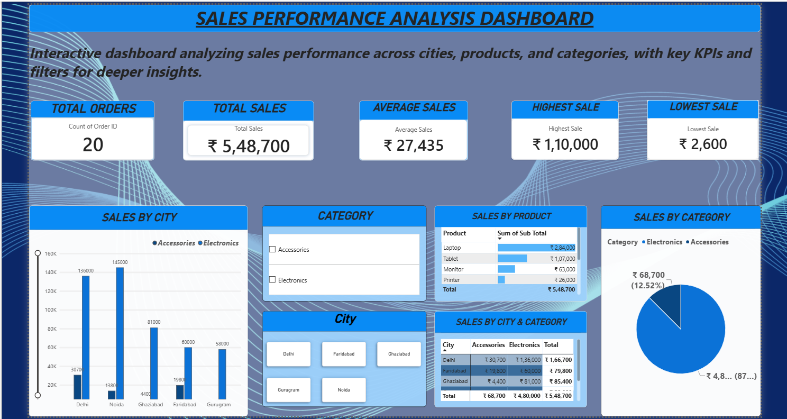

# 📊 Sales Performance Analysis Dashboard

📈 Interactive **Power BI** dashboard analyzing sales performance across cities, products, and categories.

## 📌 Project Overview
- Analyzed a sample sales dataset of 20 orders across 5 cities (Delhi, Noida, Ghaziabad, Faridabad, Gurugram) and 2 categories (Electronics, Accessories).
- Built KPI cards for Total Orders, Total Sales, Average Sales, Highest Sale, and Lowest Sale.
- Added City and Category slicers with cross-filtering across all visuals.

## 📸 Dashboard Preview

## 🔍 Key Insights
- Total sales: **₹5,48,700** across 20 orders (average ₹27,435 per order).
- **Electronics** drives about 87.5% of sales (₹4,80,000); Accessories contribute about 12.5% (₹68,700).
- **Delhi** is the top city at ₹1,66,700, followed by Noida (₹1,58,800).
- **Laptop** is the top product at ₹2,84,000, about half of total sales.
- Gurugram's sales come entirely from Electronics, with no Accessories sales recorded.

## 🛠️ Tech Stack
- Power BI Desktop
- DAX
- Microsoft Excel (data source)

## 📂 Repository Contents
- `sales_performance_dashboard.pbix`: the Power BI report
- `sales_data.xlsx`: the dataset
- `dashboard_preview.png`: dashboard screenshot

## 🚀 How to Open
1. Download the `.pbix` file.
2. Open it in Power BI Desktop (free from Microsoft).

## 👤 Author
**Rahul Diwakar** | [LinkedIn](https://www.linkedin.com/in/rahul-diwakar-645197205) | [GitHub](https://github.com/RahulDiwakar09)
